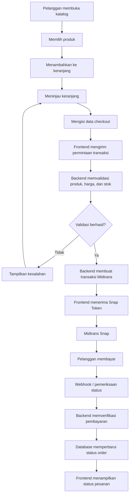

# ASRI Online Store

Aplikasi toko online **Asri Collection** yang dibangun dengan React dan dirancang untuk menggunakan Supabase sebagai backend/database serta Midtrans Snap sebagai payment gateway.

> **Status dokumentasi:** README ini disusun berdasarkan pemeriksaan `App.jsx`. Keberadaan kode konfigurasi, SQL, atau Edge Function yang tertanam di frontend tidak membuktikan bahwa seluruh tabel dan fungsi tersebut sudah dibuat atau di-deploy pada project Supabase. Verifikasi konfigurasi dan deployment sebelum transaksi produksi.

## Daftar Isi

- [Gambaran Umum](#gambaran-umum)
- [Teknologi](#teknologi)
- [Fitur dan Alur Pengguna](#fitur-dan-alur-pengguna)
- [Arsitektur Transaksi](#arsitektur-transaksi)
- [Integrasi Supabase](#integrasi-supabase)
- [Integrasi Midtrans](#integrasi-midtrans)
- [Konfigurasi Environment](#konfigurasi-environment)
- [Keamanan dan Integritas Transaksi](#keamanan-dan-integritas-transaksi)
- [Catatan Implementasi](#catatan-implementasi)
- [Checklist Sebelum Production](#checklist-sebelum-production)

## Gambaran Umum

ASRI Online Store menyediakan alur belanja online mulai dari melihat katalog, memilih produk, mengelola keranjang, mengisi data checkout, hingga melakukan pembayaran melalui Midtrans Snap.

Frontend bertanggung jawab untuk pengalaman pengguna. Validasi harga, stok, pembuatan transaksi, dan penentuan status pembayaran harus dilakukan di backend.

## Teknologi

- **Frontend:** React
- **Styling:** Tailwind CSS
- **Icons:** Lucide React
- **Backend dan database:** Supabase
- **Payment gateway:** Midtrans Snap
- **Server-side API:** Supabase Edge Functions

## Fitur dan Alur Pengguna

1. **Katalog produk** — pelanggan melihat produk, gambar, harga, dan ketersediaan.
2. **Pemilihan produk** — pelanggan memilih produk dan jumlah pembelian.
3. **Keranjang** — pelanggan meninjau item, mengubah kuantitas, atau menghapus item.
4. **Checkout** — pelanggan mengisi nama, email, nomor telepon, dan informasi pengiriman.
5. **Validasi backend** — server memeriksa produk, harga, stok, dan menghitung total transaksi.
6. **Pembuatan pembayaran** — backend membuat transaksi Midtrans dan mengembalikan Snap Token.
7. **Pembayaran** — frontend membuka Midtrans Snap agar pelanggan memilih metode pembayaran.
8. **Verifikasi** — backend memverifikasi notifikasi/status transaksi dan memperbarui pesanan.
9. **Hasil transaksi** — frontend menampilkan status pesanan berdasarkan data backend.

### Diagram Alur



## Arsitektur Transaksi

Komponen utama yang terlibat:

| Komponen | Tanggung jawab |
|---|---|
| React application | Katalog, keranjang, checkout, dan tampilan status |
| Supabase Database | Data produk, pesanan, item pesanan, dan transaksi pembayaran |
| `create-midtrans-transaction` | Validasi checkout, perhitungan total, pembuatan transaksi, dan Snap Token |
| `get-order-status` | Mengambil serta memverifikasi status pesanan |
| Midtrans webhook | Menerima notifikasi pembayaran dan menyinkronkan status |

### Urutan komunikasi

```text
Customer
  -> React App
  -> create-midtrans-transaction
  -> Supabase (validasi produk/harga/stok)
  -> Midtrans Snap API
  <- Snap Token
  <- React App membuka Midtrans Snap
  -> Customer menyelesaikan pembayaran
  -> Midtrans mengirim notifikasi ke webhook
  -> Backend memverifikasi notifikasi
  -> Supabase memperbarui status order
  -> React App meminta status pesanan
```

## Integrasi Supabase

Kode SQL yang tertanam di `App.jsx` mendefinisikan rancangan tabel berikut:

| Tabel | Kegunaan |
|---|---|
| `products` | Katalog, harga, status aktif, dan stok produk |
| `orders` | Data pesanan dan pelanggan |
| `order_items` | Rincian produk dalam setiap pesanan |
| `payment_transactions` | Informasi transaksi pembayaran |

Nama tabel di atas merujuk pada rancangan yang terlihat di kode. Periksa skema aktual di Supabase untuk memastikan kolom, tipe data, constraint, index, trigger, dan policy yang benar.

### Edge Functions

- **`create-midtrans-transaction`**: menerima data checkout, mengambil harga dari database, memvalidasi produk dan stok, menghitung total, membuat transaksi Midtrans, menyimpan order, lalu mengembalikan Snap Token.
- **`get-order-status`**: mengambil status pesanan dan, bila diperlukan, meminta status terbaru ke Midtrans.
- **Webhook Midtrans**: endpoint penerima notifikasi pembayaran. Implementasi harus memvalidasi signature dan status transaksi sebelum mengubah database.

Pastikan nama fungsi, endpoint, secrets, dan implementasi yang di-deploy sama dengan konfigurasi frontend.

## Integrasi Midtrans

Aplikasi menggunakan Midtrans Snap. Secara umum alurnya:

1. Backend membuat transaksi menggunakan Midtrans Server Key.
2. Midtrans mengembalikan Snap Token.
3. Frontend menggunakan Snap Token untuk membuka Snap.
4. Pelanggan menyelesaikan pembayaran.
5. Backend menerima notifikasi webhook dan/atau memeriksa status transaksi ke Midtrans.
6. Backend memverifikasi hasil dan memperbarui status pesanan.

**Jangan menganggap callback browser sebagai bukti pembayaran.** Status final harus berasal dari verifikasi server-side terhadap Midtrans.

### Status Pesanan

Status berikut direkomendasikan sebagai model status aplikasi; sesuaikan dengan enum/status yang benar-benar digunakan di database:

| Status aplikasi | Arti |
|---|---|
| `PENDING` | Menunggu pembayaran |
| `PAID` | Pembayaran berhasil diverifikasi |
| `FAILED` | Pembayaran gagal |
| `EXPIRED` | Batas waktu pembayaran berakhir |
| `CANCELLED` | Pesanan dibatalkan |
| `REFUNDED` | Dana dikembalikan |

Pemetaan status Midtrans ke status internal harus eksplisit dan diuji, termasuk status settlement, capture, pending, deny, cancel, expire, dan refund.

## Konfigurasi Environment

Konfigurasi berikut merupakan contoh nama variabel. Sesuaikan dengan cara aplikasi dan Edge Functions membaca konfigurasi.

### Frontend

```env
VITE_SUPABASE_URL=
VITE_SUPABASE_ANON_KEY=
VITE_MIDTRANS_CLIENT_KEY=
```

Hanya konfigurasi publik yang boleh berada di frontend. Jika aplikasi tidak menggunakan Vite, sesuaikan prefix variabel dengan build tool yang digunakan.

### Supabase Edge Functions

```env
SUPABASE_URL=
SUPABASE_SERVICE_ROLE_KEY=
MIDTRANS_SERVER_KEY=
MIDTRANS_IS_PRODUCTION=false
```

Gunakan Supabase secrets untuk nilai rahasia. Jangan pernah memasukkan Service Role Key atau Midtrans Server Key ke bundle frontend, repository publik, atau log.

### Sandbox dan Production

- Gunakan Midtrans Sandbox untuk pengembangan dan pengujian.
- Gunakan kredensial Production hanya setelah pengujian dan verifikasi konfigurasi.
- Pastikan URL Snap.js frontend dan endpoint/API Midtrans backend menggunakan environment yang sama.
- Jangan mencampur Client Key Sandbox dengan Server Key Production, atau sebaliknya.

## Keamanan dan Integritas Transaksi

Sebelum digunakan untuk transaksi sebenarnya, pastikan:

1. Harga dan total transaksi selalu dihitung di backend.
2. Kuantitas divalidasi sebagai bilangan bulat positif dengan batas maksimum yang wajar.
3. Stok diperiksa dan dikurangi secara atomik agar tidak terjadi overselling pada pembelian bersamaan.
4. Pembuatan order dan item order ditangani secara konsisten ketika salah satu operasi gagal.
5. Order reference dibuat unik dan tidak mudah ditebak; jangan menjadikannya satu-satunya bukti otorisasi.
6. Endpoint status pesanan memverifikasi identitas atau hak akses pelanggan sebelum mengembalikan data pribadi.
7. Webhook memvalidasi signature menggunakan mekanisme resmi Midtrans.
8. Webhook menangani notifikasi berulang secara idempotent.
9. Transisi status hanya mengizinkan perubahan yang valid dan tidak menurunkan status pembayaran yang sudah final secara keliru.
10. Row Level Security (RLS) dan policy diuji untuk setiap tabel.
11. Service Role Key hanya digunakan di lingkungan server.
12. Data pribadi dan kredensial tidak ditulis ke log atau respons error yang dapat diakses publik.

## Catatan Implementasi

Temuan awal dari pemeriksaan `App.jsx` yang perlu diperhatikan:

- Katalog masih memiliki data contoh lokal (`SAMPLE_CATALOG_PRODUCTS`); verifikasi integrasi katalog Supabase sebelum penggunaan nyata.
- Keranjang diinisialisasi dengan produk contoh; alur produksi sebaiknya memulai keranjang dalam keadaan kosong.
- Biaya pengiriman contoh masih berupa nilai tetap; ganti dengan perhitungan ongkir yang sesuai kebijakan bisnis.
- URL Snap.js yang terlihat menggunakan Sandbox; pastikan konsisten dengan environment backend.
- Endpoint pemeriksaan status perlu otorisasi yang memadai karena respons pesanan dapat berisi data pelanggan.
- Validasi kuantitas, perlindungan stok bersamaan, dan transaksi database perlu diperkuat.
- Kode SQL dan Edge Function yang disimpan sebagai string di frontend merupakan referensi kode, bukan bukti bahwa migrasi atau deployment sudah dilakukan.

## Checklist Sebelum Production

- [ ] Katalog membaca data produk aktual dari Supabase.
- [ ] Keranjang tidak berisi data contoh saat aplikasi dibuka.
- [ ] Harga dan stok diverifikasi di backend.
- [ ] Validasi kuantitas dan batas pembelian diterapkan.
- [ ] Pengurangan stok aman terhadap transaksi bersamaan.
- [ ] Pembuatan order dan order items konsisten saat terjadi kegagalan.
- [ ] Midtrans Sandbox berhasil diuji end-to-end.
- [ ] Webhook memvalidasi signature dan idempotency.
- [ ] Status pembayaran diverifikasi server-side.
- [ ] Endpoint status order memvalidasi hak akses.
- [ ] RLS dan policy semua tabel telah diuji.
- [ ] Secrets disimpan di konfigurasi server, bukan frontend.
- [ ] Snap.js dan API Midtrans menggunakan environment yang sama.
- [ ] Skenario pending, paid, failed, expired, cancelled, dan refund telah diuji.

---

**ASRI ONLINE STORE**  
*Online shopping experience powered by React, Supabase, and Midtrans.*
